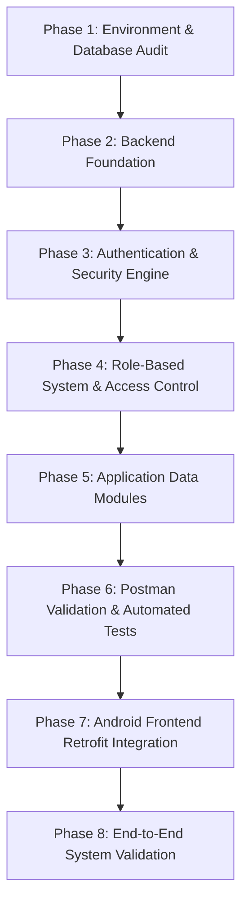

# SMA-MOVE — BACKEND ARCHITECTURE & IMPLEMENTATION PLAN

**Plan Date:** November 4, 2026  
**Architect:** Senior Backend & API Security Engineer (Antigravity)  
**Target Platform:** PHP 8.2 + MariaDB 10.4 (Apache on XAMPP)  
**Base URL:** `http://localhost/sma-move-backend/api/`  

---

## 1. Architectural Principles

1. **Modular MVC/Service-Oriented Design**: Clean separation of routing, middleware, controllers/endpoints, business services, models, and data access.
2. **Zero-Trust Server-Side Authorization**: The Android client never decides access. Every protected endpoint verifies bearer authentication, account status, user role, and resource ownership/consent.
3. **Defense-in-Depth Security**:
   - Standardized `password_hash()` with `PASSWORD_DEFAULT`.
   - Cryptographically secure tokens (`random_bytes(32)`), stored exclusively as SHA-256 hashes in MariaDB.
   - 100% prepared SQL statements via PDO to eliminate SQL injection.
   - Protection against user enumeration via uniform authentication and recovery errors.
   - In-memory / database rate limiting on authentication routes.
4. **Consistent JSON REST API Standard**: Uniform response envelope across all success and error scenarios.
5. **Privacy First (Healthcare SMA Compliance)**:
   - Fine-grained, patient-revocable consent.
   - Minimal session metadata only for MoveTrack (NO raw camera frames or biometric images uploaded).

---

## 2. Directory & File Structure

```
sma-move-backend/
│
├── config/
│   ├── config.php                 # Global app constants and configuration
│   ├── database.php               # Robust PDO MariaDB connection factory
│   └── environment.php            # .env file parser and environment loader
│
├── api/
│   ├── auth/
│   │   ├── signup.php             # POST: Register patient/caregiver/professional
│   │   ├── login.php              # POST: Authenticate user & issue bearer/refresh tokens
│   │   ├── logout.php             # POST: Revoke active session token
│   │   ├── me.php                 # GET:  Current authenticated user & profile summary
│   │   ├── forgot_password.php    # POST: Initiate password reset request
│   │   ├── reset_password.php     # POST: Complete password reset with secure token
│   │   └── refresh_token.php      # POST: Rotate expired access token using refresh token
│   │
│   ├── patient/
│   │   ├── profile.php            # GET/PUT: Patient profile data
│   │   ├── dashboard.php          # GET: Aggregated dashboard (tasks, wellbeing, alerts)
│   │   ├── care_plans.php         # GET/POST: Patient daily care tasks & completions
│   │   ├── appointments.php       # GET/POST/PATCH: Patient appointment management
│   │   └── wellbeing.php          # GET/POST: Patient wellbeing check-in & journal
│   │
│   ├── caregiver/
│   │   ├── profile.php            # GET/PUT: Caregiver profile details
│   │   ├── request_access.php     # POST: Request link to patient via invitation code
│   │   ├── patients.php           # GET: List authorized linked patients
│   │   ├── approve_request.php    # POST: Patient approves caregiver access request
│   │   └── revoke_access.php      # POST: Patient or caregiver revokes relationship
│   │
│   ├── professional/
│   │   ├── profile.php            # GET/PUT: Clinical practitioner profile
│   │   ├── submit_verification.php# POST: Submit registration number, license & council
│   │   └── verification_status.php# GET: Query credential verification state
│   │
│   ├── consent/
│   │   ├── get_consent.php        # GET: Current consent preferences
│   │   ├── camera_consent.php     # POST: Update camera tracking consent
│   │   ├── sharing_consent.php    # POST: Update caregiver/clinical sharing consent
│   │   └── revoke_consent.php     # POST: Immediate revocation of all/selected consents
│   │
│   └── movetrack/
│       ├── create_session.php     # POST: Log session metadata (duration, quality, type)
│       ├── session_history.php    # GET: Patient session history summary
│       └── session_details.php    # GET: Individual session telemetry metadata
│
├── middleware/
│   ├── auth_middleware.php        # Validates Bearer token & active account status
│   ├── role_middleware.php        # Enforces patient / caregiver / professional role
│   ├── cors.php                  # Cross-Origin headers & preflight OPTIONS handler
│   └── request_validation.php    # JSON body parser & input validation helper
│
├── models/
│   ├── User.php                   # User account entity & queries
│   ├── PatientProfile.php         # Patient demographic entity
│   ├── ProfessionalProfile.php    # Professional credentials entity
│   ├── CaregiverRelationship.php  # Relationship & invitation entity
│   ├── CareTask.php               # Care plan tasks & completions entity
│   ├── Appointment.php            # Scheduled appointments entity
│   ├── WellbeingEntry.php         # Mood, comfort, fatigue journal entity
│   ├── Consent.php                # Privacy consent records entity
│   └── MoveTrackSession.php       # Movement tracking metadata entity
│
├── services/
│   ├── AuthService.php            # Signup, login, password management, token lifecycle
│   ├── PatientService.php         # Patient dashboard, care plan, wellbeing logic
│   ├── CaregiverService.php       # Invitation codes, link validation, authorization
│   ├── ProfessionalService.php    # Professional registration, status management
│   └── ConsentService.php         # Consent enforcement & MoveTrack session validation
│
├── utils/
│   ├── response.php               # Standard JSON response helper (success, error, http codes)
│   ├── validation.php             # Input validation rules (email, password strength, regex)
│   ├── token.php                  # CSPRNG token generator & SHA-256 hasher
│   └── rate_limiter.php           # Rate limiting against brute-force attacks
│
├── database/
│   ├── schema.sql                 # Baseline database definition
│   ├── migrations/                # Versioned, incremental migration scripts
│   │   ├── 001_auth_tokens.sql
│   │   ├── 002_caregiver_relationships.sql
│   │   ├── 003_care_plans.sql
│   │   ├── 004_appointments.sql
│   │   ├── 005_wellbeing.sql
│   │   └── 006_consents_movetrack.sql
│   └── migrate.php                # CLI migration runner
│
├── tests/
│   ├── run_all_tests.php          # Comprehensive integration test runner
│   ├── AuthTest.php
│   ├── RoleAccessTest.php
│   ├── PatientModuleTest.php
│   ├── CaregiverModuleTest.php
│   └── MoveTrackConsentTest.php
│
├── docs/
│   ├── ENVIRONMENT_AUDIT.md
│   ├── DATABASE_AUDIT.md
│   ├── BACKEND_IMPLEMENTATION_PLAN.md
│   ├── ANDROID_INTEGRATION_PLAN.md
│   ├── API_DOCUMENTATION.md
│   └── DATABASE_DOCUMENTATION.md
│
├── .htaccess                      # Apache rewrite rules for clean REST routing
├── .env.example                   # Example environment variables template
├── .env                           # Local environment configuration (git ignored)
├── .gitignore
└── README.md
```

---

## 3. Phased Implementation Sequence



### Phase 1: Environment and Database Audit (Completed)
- Completed environment verification (PHP 8.2, Apache 2.4, MariaDB 10.4).
- Completed non-destructive database inspection of `sma_move`.
- Documented findings in `ENVIRONMENT_AUDIT.md` and `DATABASE_AUDIT.md`.

### Phase 2: Backend Foundation & Infrastructure
- Implement `.env` parser and environment loader.
- Create secure, thread-safe MariaDB PDO connection factory in `config/database.php` (UTF-8mb4, persistent prepared statement security).
- Implement standard response handler (`utils/response.php`) enforcing the JSON envelope.
- Implement input validation and error handler capturing PHP fatal errors cleanly as 500 JSON responses.
- Implement CORS middleware (`middleware/cors.php`) supporting Android requests and preflights.
- Create initial migrations runner (`database/migrate.php`).

### Phase 3: Authentication & Account Security Engine
- **Signup Endpoint (`/api/auth/signup.php`)**:
  - Validates full name, email format, password complexity (min 8 chars, mixed case, number).
  - Verifies email uniqueness.
  - Generates secure `password_hash()`.
  - Atomically creates user record and linked profile stub (`patient_profiles`, `professional_profiles`, or `caregiver_profiles`) inside a database transaction.
- **Login Endpoint (`/api/auth/login.php`)**:
  - Rate-limited (max 5 failed attempts per IP/email per 15 minutes).
  - Fetches user by email; uses `password_verify()`.
  - Checks `account_status` (blocks `suspended` accounts).
  - Generates 64-character random bearer token and refresh token.
  - Stores SHA-256 hash of tokens in `auth_tokens`.
  - Returns bearer token, expiry, user details, and profile completeness status.
- **Current User Endpoint (`/api/auth/me.php`)**:
  - Resolves active Bearer token and returns authenticated identity and role.
- **Logout Endpoint (`/api/auth/logout.php`)**:
  - Immediately marks token as revoked (`revoked_at = NOW()`).
- **Token Refresh Endpoint (`/api/auth/refresh_token.php`)**:
  - Validates refresh token, rotates token pair, revokes old refresh token.
- **Password Recovery & Reset (`/api/auth/forgot_password.php`, `/api/auth/reset_password.php`)**:
  - Non-enumerating reset token creation and verification.

### Phase 4: Role-Based System & Access Control
- Implement `role_middleware.php` providing `requireRole(['patient'])`, `requireRole(['caregiver'])`, `requireRole(['professional'])`.
- **Caregiver Linking Workflow**:
  - Patient generates or views invitation code (`SMA-XXXX`).
  - Caregiver submits invitation code via `/api/caregiver/request_access.php`.
  - Relationship created in `pending` status.
  - Patient reviews, approves, or rejects request via `/api/caregiver/approve_request.php`.
  - Server verifies that caregiver CANNOT view any patient data unless `access_status = 'approved'`.
- **Professional Credential Verification Workflow**:
  - Specialist submits registration number, medical council jurisdiction, and institution.
  - Status set to `pending`.
  - Unverified professionals are restricted from querying clinical patient data.

### Phase 5: Application Data Modules
- **Patient Profile & Dashboard Module**:
  - Profile retrieval & update.
  - Aggregated dashboard endpoint calculating daily task completion percentage, upcoming appointments, and recent wellbeing status.
- **Care Plan & Daily Tasks Module**:
  - List daily tasks with multi-step protocols (e.g. Cough Assist, Positioning, Hydration).
  - Toggle task completion for the current date with timestamp persistence.
- **Appointments Module**:
  - View upcoming clinical sessions, specialist names, scheduled dates, and video consultation join links.
  - Book or cancel appointments.
- **Wellbeing Check-in & Journal Module**:
  - Persist daily check-ins (mood, comfort rating, fatigue level, mobility assistance needed, notes).
  - History query for trends and care team awareness.
- **Consent & MoveTrack Module**:
  - Manage granular consents: `camera_tracking`, `caregiver_sharing`, `clinical_sharing`.
  - Immediate revocability.
  - Persist MoveTrack evaluation session metadata (session duration, tracking quality, model version, notes). No raw images stored.

### Phase 6: Postman Validation & Automated Integration Test Suite
- Comprehensive PHP CLI test runner (`tests/run_all_tests.php`) testing all positive and negative test cases.
- Exportable Postman collection (`docs/SMA_Move_Postman_Collection.json`) with environment variables and sample requests.

---

## 4. API Standard Response Envelope

All API endpoints will strictly adhere to the following JSON structure:

### Successful Response Format
```json
{
  "success": true,
  "message": "Operation completed successfully",
  "data": {
    "user": {
      "id": 1,
      "full_name": "Alex Mercer",
      "email": "alex@smamove.com",
      "role": "patient",
      "account_status": "active"
    }
  }
}
```

### Error Response Format
```json
{
  "success": false,
  "message": "Invalid credentials provided",
  "data": null,
  "errors": []
}
```

### HTTP Status Code Matrix
- `200 OK`: Successful read or update.
- `201 Created`: Successful resource creation (signup, session created, check-in logged).
- `400 Bad Request`: Malformed JSON or invalid syntax.
- `401 Unauthorized`: Missing, expired, or revoked Bearer token.
- `403 Forbidden`: Authenticated user does not possess required role, or relationship is not approved.
- `404 Not Found`: Resource does not exist or user lacks access.
- `409 Conflict`: Duplicate email registration or conflicting invitation code.
- `422 Unprocessable Entity`: Validation failure on required fields.
- `429 Too Many Requests`: Rate limit exceeded on authentication endpoints.
- `500 Internal Server Error`: Unhandled server exception (internal details concealed from client).
